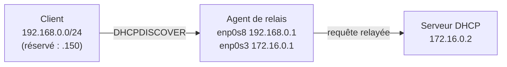
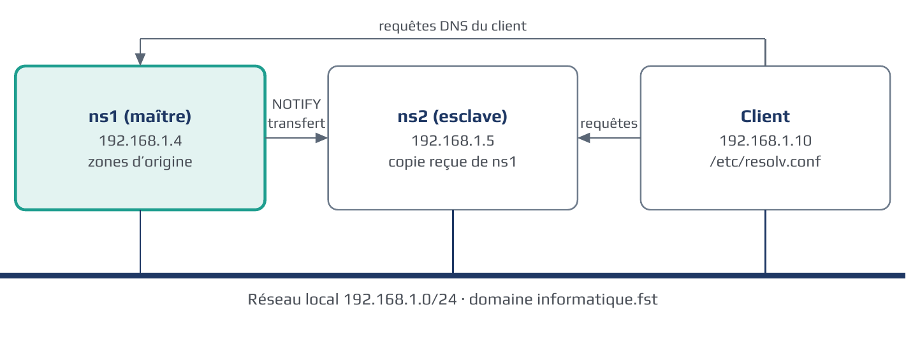
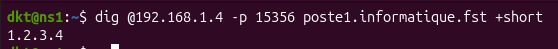
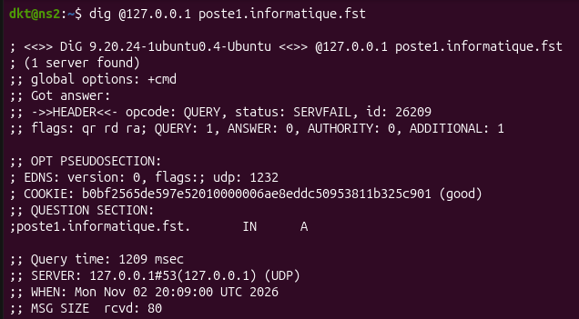

# Lab DHCP, DNS et DNSSEC sous Linux

Laboratoire réseau d'entreprise monté sur des machines virtuelles **Ubuntu Server 24.04** (VirtualBox) :
un serveur DHCP derrière un agent de relais, un DNS BIND9 maître/esclave, la signature de la zone
avec **DNSSEC**, puis un **test d'attaque** : un faux serveur DNS envoie une réponse falsifiée, et le
résolveur validant la rejette.

Réalisé en binôme dans le cadre du Master Cloud & IoT (FST Fès, module Administration réseau d'entreprise).
Ce dépôt contient les fichiers de configuration réels des machines, extraits en fin de TP.

## Ce que montre ce lab

| Partie | Mis en place |
|---|---|
| DHCP | Deux étendues (172.16.0.0/24 et 192.168.0.0/24), baux de 60 s et 180 s, réservation d'adresse par adresse MAC |
| Relais DHCP | Une machine routeur entre deux réseaux relaie les requêtes vers le serveur (`isc-dhcp-relay`) |
| DNS | Zone directe et zone inverse de `informatique.fst`, enregistrements A, NS, PTR et CNAME |
| Réplication | ns2 reçoit les zones de ns1 par transfert (NOTIFY, AXFR/IXFR) et continue de répondre quand ns1 est arrêté |
| DNSSEC | Signature automatique des zones sur ns1 avec une politique sur mesure (KSK et ZSK RSASHA256 2048 bits) |
| Validation | ns2 valide les signatures grâce à la clé publique de la zone (ancre de confiance) |
| Test d'attaque | Une réponse falsifiée est rejetée par la validation DNSSEC |

## 1. DHCP avec agent de relais



Le client et le serveur ne sont pas sur le même réseau. Les requêtes DHCP sont des broadcasts, qui ne
traversent pas un routeur : l'agent de relais les reçoit et les transmet au serveur en unicast.

| Fichier | Rôle |
|---|---|
| [`serveur-dhcp/etc/dhcp/dhcpd.conf`](01-dhcp-relais/serveur-dhcp/etc/dhcp/dhcpd.conf) | Les deux étendues, passerelles, serveurs DNS, réservation `client-reserve` |
| [`serveur-dhcp/etc/default/isc-dhcp-server`](01-dhcp-relais/serveur-dhcp/etc/default/isc-dhcp-server) | Interface sur laquelle le serveur écoute |
| [`agent-relais/etc/default/isc-dhcp-relay`](01-dhcp-relais/agent-relais/etc/default/isc-dhcp-relay) | Adresse du serveur et interfaces relayées |
| `*/etc/netplan/*.yaml` | Adressage statique des serveurs, DHCP côté client |

## 2. DNS maître/esclave et DNSSEC



| Fichier | Rôle |
|---|---|
| [`ns1-maitre/etc/bind/named.conf.options`](02-dns-bind9-dnssec/ns1-maitre/etc/bind/named.conf.options) | Déclare la politique DNSSEC `tp2DNS` |
| [`ns1-maitre/etc/bind/named.conf.local`](02-dns-bind9-dnssec/ns1-maitre/etc/bind/named.conf.local) | Déclare les zones, autorise le transfert vers ns2, applique la politique (`inline-signing`) |
| [`ns1-maitre/var/cache/bind/*.db`](02-dns-bind9-dnssec/ns1-maitre/var/cache/bind/) | Zones directe et inverse |
| [`ns1-maitre/var/cache/bind/dnssec-cles-publiques/`](02-dns-bind9-dnssec/ns1-maitre/var/cache/bind/dnssec-cles-publiques/) | Clés **publiques** générées par BIND |
| [`ns2-esclave/etc/bind/named.conf.local`](02-dns-bind9-dnssec/ns2-esclave/etc/bind/named.conf.local) | Les deux zones en esclave de ns1 |
| [`ns2-esclave/etc/bind/named.conf.options`](02-dns-bind9-dnssec/ns2-esclave/etc/bind/named.conf.options) et [`trust-anchors.conf`](02-dns-bind9-dnssec/ns2-esclave/etc/bind/trust-anchors.conf) | Validation DNSSEC avec la clé publique de la zone |

**Pourquoi une politique DNSSEC sur mesure ?** La politique `default` de BIND limite le TTL des
enregistrements à 1 jour, alors que les zones du lab utilisent 7 jours (`$TTL 604800`). La politique
`tp2DNS` déclare donc `max-zone-ttl 7d`. Le piège : `named-checkconf` valide la configuration sans
erreur, le problème n'apparaît qu'au chargement de la zone.

## 3. Test d'attaque : réponse DNS falsifiée

Objectif : prouver que DNSSEC protège réellement le client, pas seulement que la configuration est valide.

1. Sur ns1, une copie de la zone remplace l'adresse de `poste1` par `1.2.3.4`
   ([`fausse_zone.db`](02-dns-bind9-dnssec/test-dnssec-faux-serveur/fausse_zone.db)). Un second BIND la
   sert sur le port 15356 ([`faux_serveur.conf`](02-dns-bind9-dnssec/test-dnssec-faux-serveur/faux_serveur.conf)) :

   ```bash
   sudo named -c /var/cache/bind/faux_serveur.conf -f -g
   ```

   Interrogé directement, le faux serveur donne bien la fausse adresse :

   

2. Sur ns2, la zone est temporairement redirigée vers ce faux serveur
   ([`ns2-named.conf.local.test`](02-dns-bind9-dnssec/test-dnssec-faux-serveur/ns2-named.conf.local.test)).

3. Résultat : ns2, résolveur validant, refuse la réponse et renvoie **SERVFAIL**. Le faux serveur n'a pas
   la clé privée de la zone : il ne peut pas produire de signature valide pour la fausse adresse.

   

Sans DNSSEC, le client aurait reçu `1.2.3.4` sans aucun moyen de savoir que la réponse était fausse.

## Points d'attention rencontrés

- Sans `NOTIFY`, l'esclave peut attendre la fin du délai `refresh` (7 jours ici) avant de voir une modification : il faut augmenter le numéro de série à chaque changement.
- Les fichiers de zone reçus par ns2 sont au format binaire, illisibles avec `cat`. Ce n'est pas une panne ; `masterfile-format text;` les rend lisibles.
- `named-checkconf /etc/bind/named.conf.local` ne contrôle que ce fichier : lancer `named-checkconf` sans argument vérifie toute la configuration.

## Non publié

Les clés privées DNSSEC (`*.private`), la clé `rndc.key` et les journaux BIND (`*.jnl`) ne sont pas dans
ce dépôt : voir [`.gitignore`](.gitignore). Les sujets de TP appartiennent à l'enseignant et ne sont pas inclus.
